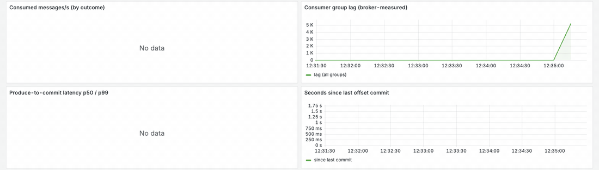
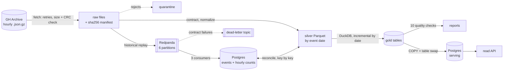
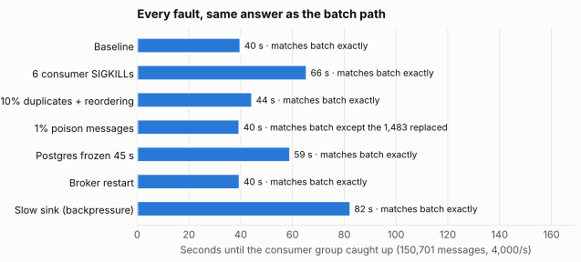
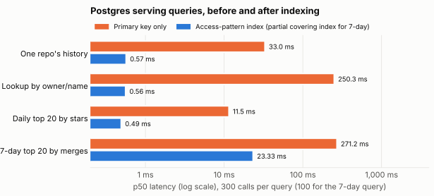
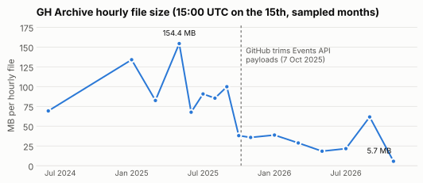
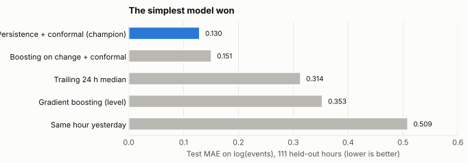
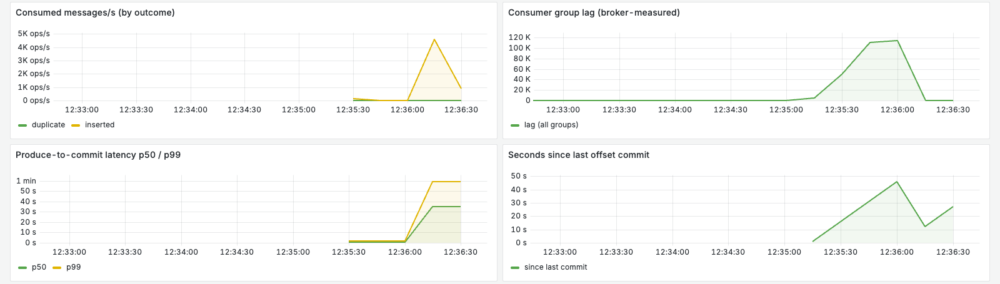

<h1 align="center">repostream</h1>

<b>A batch and streaming pipeline over public GitHub activity, tested by breaking it on purpose.</b>

Python · DuckDB · Parquet · Redpanda (Kafka API) · Postgres 17 · Prometheus · Grafana · FastAPI · scikit-learn · MLflow · Docker · GitHub Actions · Terraform

Runs on one laptop with Docker. Not deployed, no users. Source is private; this repository holds the write-up, the raw results and the charts.

<picture>
  <source media="(prefers-color-scheme: dark)" srcset="assets/gifs/outage-live-dark.gif">
  
</picture>

Recorded live: Postgres frozen with <code>docker pause</code> for 45 s mid-stream. Lag climbs and commits stop (the stall alert fired at 46.8 s in this run); after the database returns, the backlog drains. The result still matched the batch path on every key.

## What it does

[GH Archive](https://www.gharchive.org/) publishes the public GitHub event stream as one gzip file per hour. Turning that into numbers you can trust is harder than it looks: files differ in completeness, GitHub changed the event format in October 2025, a few records are malformed, and the same event can appear twice.

repostream processes the same events twice and makes the two answers agree:

- **Batch:** download each hour with integrity checks, validate every event against a schema contract that understands both payload formats, write Parquet partitioned by event date, build deduplicated tables in DuckDB, run 10 data-quality checks, and load Postgres for an API.
- **Stream:** replay the same raw events through Redpanda into three consumer containers that write to Postgres. Offsets are committed only after the database commit, and the writes are idempotent, so redelivery never double-counts.
- **Reconcile:** after every run, compare the streamed counts with the batch counts on every (repository, hour, event type) key.

## Results

Measured on an Apple M1 Pro laptop, 25 Nov 2026, with real GH Archive data for 1–24 Nov 2026: **4.83 million events**, 2.77 GB compressed. 69 malformed records were quarantined, 37 duplicates removed, and the 10 quality checks reported 0 errors.

### Seven ways to break the stream

Each experiment replays the same real day (150,701 messages) at 4,000 messages per second into three consumers, injects one fault, waits for the consumer group to catch up, then reconciles. Alerts are read from Prometheus during the run, so "the alert fired" is recorded, not assumed.

<picture>
  <source media="(prefers-color-scheme: dark)" srcset="assets/charts/experiments-dark.svg">
  
</picture>

| Fault | What happened |
| --- | --- |
| 6 consumers killed with SIGKILL | Partitions moved to the survivors; redelivered messages inserted nothing. Exact match. |
| 10% duplicates, shuffled in a 20,000-message window | 14,958 extra copies, none counted twice. Exact match. |
| 1% poison messages | All 1,483 went to the dead-letter topic with a reason; the stream kept running; the dead-letter alert fired. |
| Postgres frozen for 45 s | The consumers hung inside a query that never returned. The stall alert fired at 45 s and the lag alert at 59 s; nothing was lost. |
| Broker restart | About 4.5 s p99 latency, no alert, exact match. |
| Slow database writes | Lag grew to about 77,000 and the lag alert fired. Lag waits in the broker, not in memory: each consumer read 140–173 MiB (limit 512 MiB) after the run. Exact match. |

### What testing caught

The experiments were built to find problems, and they did. Each one below was fixed and re-tested:

- **A wrong watermark.** The first version flagged 1,461 events in a clean run as late. Partitions are read at different speeds, so a per-worker maximum is wrong; it is now the minimum across partitions.
- **Monitoring that went blind.** During the database freeze, the consumers' own lag gauge froze with them and no alert fired. Lag is now measured by the broker, and a separate alert watches for commits stopping.
- **Stale broker metrics.** Redpanda recomputed group lag every 60 s by default, so lag looked about half its real size. Now every 5 s.
- **An alert that fired forever when idle.** The SLO burn rule divided 0 by 0. It now evaluates only while events flow.
- **A deadlock.** An integration test with 8 concurrent writers deadlocked on the events table's unique index (3 of 3 runs). Inserting in key order fixed it (0 of 3).
- **A parser crash.** A property-based test found that a non-object `pull_request` field crashed normalization, which would have blocked a Kafka partition. Nested fields are now type-checked.

### Database work

<picture>
  <source media="(prefers-color-scheme: dark)" srcset="assets/charts/indexes-dark.svg">
  
</picture>

Indexes were chosen from the API's queries. The 7-day leaderboard was the one they did not fix. Its plan showed a hash aggregate spilling to disk, but giving it more memory changed nothing (271 → 269 ms). Skipping rows with zero merges, which can never reach a top 20 by merges, with a partial covering index made it an index-only scan: 271 → 23 ms, with identical results on 100 random windows.

Same 2.56M-row table in both engines: DuckDB answered a full-table rollup in 1.9 ms against Postgres's 119 ms, and Postgres answered a single-repo lookup in 0.56 ms against DuckDB's 3.9 ms. One day of data takes 5.4 MB as Parquet and 23.7 MB as a Postgres heap.

### The data had stories of its own

<picture>
  <source media="(prefers-color-scheme: dark)" srcset="assets/charts/archive-size-dark.svg">
  
</picture>

- The archive's hourly files shrank from 134 MB (January 2025) to 5.7 MB (November 2026), and capture now swings by event type from day to day.
- GitHub's October 2025 payload change silently removed one metric: new repositories went from 12,716 on one September 2025 day to zero every day in November. A quality check flags it.
- Time-to-merge now needs both the "opened" and "merged" events to be captured. Only 3,494 of 293,344 November merges have both, and the sample loses slow pull requests (p90 drops from 97 h to 16 h). The project does not report per-repository merge times for that reason.

More in [docs/data-findings.md](docs/data-findings.md).

### A model that lost, kept on purpose

<picture>
  <source media="(prefers-color-scheme: dark)" srcset="assets/charts/ml-dark.svg">
  
</picture>

The goal was to flag hours whose captured volume is implausibly low. A gradient-boosted forecaster lost to "same as last hour" (difference 0.224 in log error, 95% bootstrap interval 0.072 to 0.430), and its 90% interval covered only 45% of test hours, because the test days had a capture regime change. The kept monitor is persistence with a split-conformal band: 89% coverage of the 90% target, and it catches 90% of injected 30% drops at a 6.6% false-alarm rate. It is versioned in a small registry with promote and rollback. The detection numbers come from synthetic drops on 111 real test hours.

## Engineering

- **Delivery:** at-least-once from Kafka, exactly-once results in Postgres (`INSERT … ON CONFLICT DO NOTHING RETURNING`, with the hourly counts incremented only from returned rows in the same transaction). See [docs/decisions](docs/decisions).
- **Batch layers:** atomic file publishing, sha256 checkpoints, one output file per source hour, so reprocessing an hour touches only its own files; gold rebuilds only the dates that new hours touched.
- **Operations:** Prometheus alerts tested against injected faults, a Grafana dashboard, SLOs with burn-rate alerting ([docs/slo.md](docs/slo.md)), runbooks, and a backup/restore test (identical counts after restore).
- **Infrastructure:** Docker Compose with health checks, localhost-only ports and Docker secrets; a non-root, read-only consumer image with 0 fixable HIGH/CRITICAL findings in Trivy; GitHub Actions running lint, types, 48 tests, dependency audit, image scan and Terraform validation.
- **Cloud design:** Terraform for Google Cloud (Cloud Run job, Cloud SQL, Cloud Storage, Secret Manager, per-workload service accounts). It is validated and scanned but **never applied**; the cost estimate is in [docs/cloud.md](docs/cloud.md).
- **Security review:** [docs/security.md](docs/security.md), including the gaps that remain.

<picture>
  <source media="(prefers-color-scheme: dark)" srcset="assets/screens/outage-dashboard-dark.png">
  
</picture>

## Honest status

- **Local only.** Everything runs on one laptop; consumers, broker and database share 8 cores. Absolute throughput says little about a cluster. The relative results (exact reconciliation under faults, the index and engine comparisons) are what carry over.
- **Replay, not live.** The stream replays archived hours at a fixed rate.
- **A sample of GitHub.** GH Archive captures a small, varying share of public activity, so every number means "as captured by GH Archive".
- **Not deployed.** The cloud design has never been applied.
- **Source is private.** The full report is in [docs/report.md](docs/report.md) and every raw result file is in [results/](results). The charts are generated from those files by [tools/make_charts.py](tools/make_charts.py).

## Data

The events come from GH Archive, which records GitHub's public event timeline. The project keeps downloads local, drops user logins at the first processing step (only numeric ids and a bot flag remain), has no table or endpoint keyed by person, and publishes aggregates only.

## Licence

The text, charts and result files in this repository are MIT licensed. The source code is not included.
