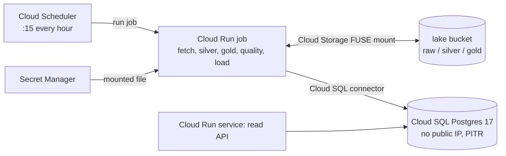

# Cloud design (not deployed)

`infra/terraform/gcp` describes how the batch path and serving database would run on Google Cloud. It passes `terraform validate` and `trivy config` with no HIGH or CRITICAL findings. **It has never been applied.** Applying it creates billable resources; do that only in a sandbox project with a budget alert, then `terraform destroy`.

## Shape

Each workload has its own service account: the batch job can read and write the bucket and connect to Cloud SQL; the API can only connect to Cloud SQL (and its database role is read-only). The bucket blocks public access and keeps three old versions of each object; raw files move to Coldline after 30 days and are deleted after a year, since they can be downloaded again from GH Archive.

## Why this and not something bigger
- **Cloud Run jobs, not Kubernetes:** one hourly job and one small API. A cluster's base cost and upkeep buy nothing here.
- **The same code locally and in the cloud:** the bucket is mounted as a directory, so the pipeline reads and writes the same paths. Caveat: on a FUSE mount, rename is copy + delete, not atomic. That is acceptable because every path has exactly one writer (one file per source hour), but it is a real difference from local disk.
- **The streaming tier is not in the Terraform.** Options, in order of cost: Pub/Sub (needs a second consumer implementation; Pub/Sub has no partition ordering by default, ordering keys give per-key order), Redpanda Serverless or Confluent Cloud (Kafka API, same code), Google Managed Service for Apache Kafka (Kafka API, but a minimum cluster size sized for far more traffic than this). For a replayed stream used in experiments, running it locally is the right call.

## Cost estimate (not a quote)
List prices change and differ by region. The figures below use the Cloud SQL Enterprise rates shown on the pricing page on 25 Nov 2026 for us-west8 (vCPU USD 0.0413/h, memory USD 0.007/GiB-h); asia-southeast1 is usually somewhat higher. Check https://cloud.google.com/sql/pricing and the pricing calculator before applying.

| Item | Assumption | Approx. USD / month |
| --- | --- | --- |
| Cloud SQL, 1 vCPU, 3.75 GiB, zonal | 730 h | about 30 (vCPU) + 19 (memory) = 49 |
| Cloud SQL storage + backups | 20 GB SSD, 7 daily backups | about 5 |
| Cloud Run job | 2 vCPU, 4 GiB, about 3 min per run, 720 runs | under 10 before the monthly free tier, possibly 0 after it |
| Cloud Storage | about 4 GB per month of new raw data (Nov 2026 volume), Coldline after 30 days | under 1 |
| Scheduler, Secret Manager, logging | 1 job, 1 secret, light logs | under 1 |
| **Total** | | **roughly 55 to 65** |

The database is most of the bill. Cheaper options: a shared-core tier (development only), stopping the instance outside a demo window, or serving from DuckDB files in the bucket for read-only dashboards (losing concurrent writes and the stream sink). Making the instance regional (high availability) roughly doubles its cost.

## What "done" would mean for the cloud part
1. Apply in a sandbox project with a budget alert (needs Yousof's approval and billing).
2. Run one backfill day and one hourly job, check quality and freshness alerts in Cloud Monitoring.
3. Restore Cloud SQL from a backup into a new instance and run `repostream reconcile` against it.
4. Destroy everything and record the actual bill.
